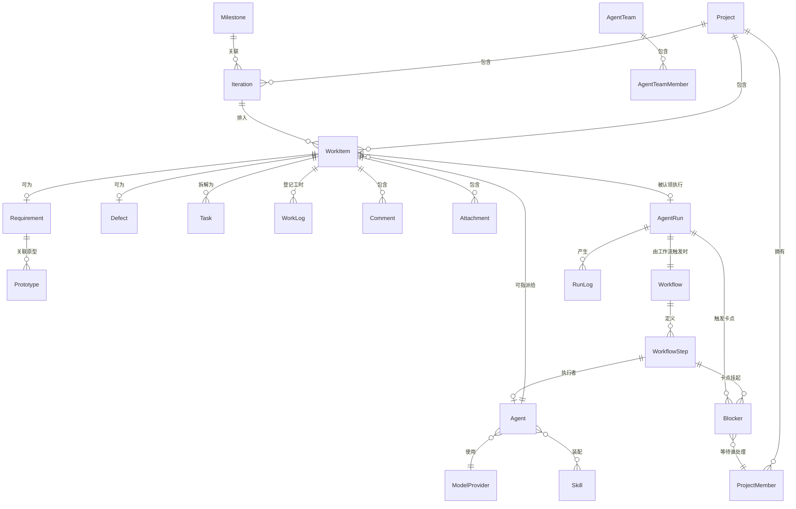
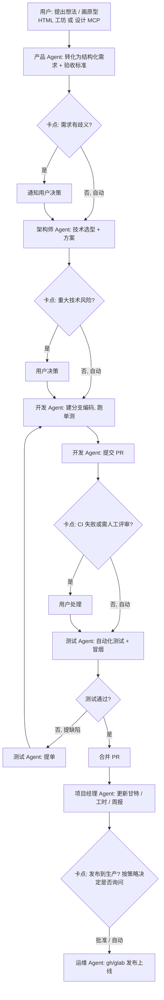
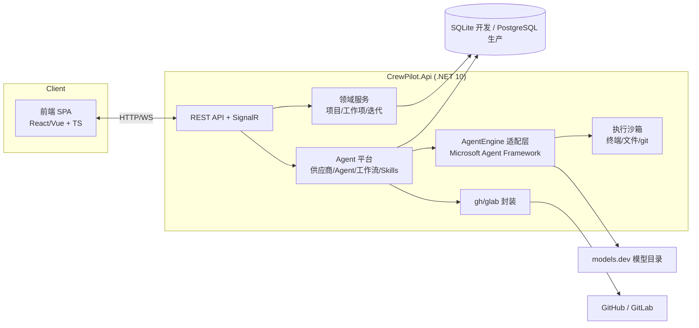

# Crew Pilot 产品需求文档（PRD）

## 0. 文档信息

| 项目     | 内容                                         |
| -------- | -------------------------------------------- |
| 产品名称 | Crew Pilot（机组成员 · 领航员）              |
| 目标用户 | 单一负责人（Solo Owner）+ Agent 数字员工团队 |
| 文档版本 | v1.0                                         |
| 文档状态 | 初稿，待评审                                 |
| 日期     | 2026-11-03                                   |
| 关联仓库 | `e:\repos\crew-pilot`                        |

---

## 1. 背景与产品愿景

### 1.1 用户意图（原始描述）

> 我想做的是 PM 工具和 Agent 结合，Agent 就像员工工作一样，自己在项目里认领需求、BUG 等完成，自动进行测试、冒烟测试、发版等等。

### 1.2 理想场景（原始描述）

> 我想做一个项目，不断和产品对需求，产品给我画原型，确定之后，交付给架构师做技术选型以及引领开发者进行开发、测试，项目经理管理进度，运维负责发版等等（当然，这个流程可以优化）。

### 1.3 问题定义

传统项目管理工具（Jira、Linear、禅道等）解决"**事**"的管理：需求、缺陷、排期、看板。但事最终还是靠"**人**"去推：

- 需求澄清靠开会，状态更新靠人肉同步；
- 测试、冒烟、发版靠工程师手动执行，重复劳动多；
- 角色之间（产品 → 架构 → 开发 → 测试 → 运维）交接靠口头/文档，信息损耗大；
- 项目经理需要不断催进度、拼甘特图、写周报。

与此同时，AI Agent 已经能在受控环境中完成"读需求 → 写代码 → 跑测试 → 提 PR → 发版"这类有明确输入输出的流程化工作，但缺少一个像 PM 工具那样**管理 Agent 本身**的平台：谁在干什么、干到哪一步、产出是什么、花了多少 token、哪一步需要人审批。

### 1.4 产品定位

**Crew Pilot = 一个人的项目驾驶舱 + 一队 AI 数字员工。**

- 面向**单一负责人（Solo Owner）**：独立开发者 / 一人技术负责人 / 独立产品经理。人类侧只有"你"一个角色，产品、架构、开发、测试、运维全由你兼任——但执行全部交给 Agent 员工，**大部分时间不需要你参与**；
- 对 Agent：每个岗位对应一个数字员工（产品 / 架构师 / 开发 / 测试 / 项目经理 / 运维），它们作为项目成员认领工作项，按工作流自动执行，全程留痕、可审计、可随时接管；
- 对工作流：默认**自动驾驶**——步骤自动通过，**只有出现"卡点"（Agent 无法自行决策的事项）时才挂起并通知用户**；每个步骤的审批策略可配置（自动通过 / 仅卡点时询问 / 总是询问），该审的照审；
- 对原型：**产品 Agent 根据你的描述直接产出可运行 HTML 原型**（工坊实时预览、版本留档），也可对接设计 MCP，原型来源不设限制；你只负责评审与提意见；

一句话：**你是经理，Agent 是员工；没事不打扰，出事才叫你。**

### 1.5 成功指标（MVP 阶段）

| 指标                 | 目标                                                     |
| -------------------- | -------------------------------------------------------- |
| 端到端自动驾驶       | 需求交付流在"仅卡点询问"策略下无人工跑通 ≥ 1 次          |
| 人工介入率           | 每次工作流需用户决策次数 = 卡点数，且每步策略可配置      |
| Agent 执行 100% 留痕 | 每次 AgentRun 有完整日志、产物、工时与 token 成本        |
| 随时接管             | 任意 Agent 工作项可在任意时刻切回人工                    |
| 原型闭环             | HTML 工坊 / 设计 MCP 的原型可被产品 Agent 转为结构化需求 |
| 工时可视             | 燃尽图、甘特图、工时报表覆盖全部工作项                   |

---

## 2. 目标用户与角色

### 2.1 目标用户：单一负责人（Solo Owner）

Crew Pilot 面向**一个用户**：独立开发者 / 一人技术负责人 / 独立产品经理。所有人类角色由这一个人兼任，**不假设团队里还有其他人类成员**。用户只做两件事：**做决策**与**处理卡点**，其余执行全部交给 Agent 员工。

> 多人协作（邀请成员、分配角色）不在主线范围；数据模型为将来的小团队形态预留，MVP 不做。

### 2.2 人类角色（全部由唯一用户兼任）

| 角色     | 用户何时亲自上场                               | 其余时间                      |
| -------- | ---------------------------------------------- | ----------------------------- |
| 产品经理 | 提出想法、画原型、拍板优先级、处理需求歧义卡点 | 产品 Agent 整理需求与验收标准 |
| 架构师   | 重大技术风险、选型分歧等卡点                   | 架构师 Agent 出方案与 ADR     |
| 开发者   | CI 反复失败、PR 需人工评审等卡点               | 开发 Agent 编码、提 PR        |
| 测试     | 冒烟失败需人工确认环境等卡点                   | 测试 Agent 自动测试、提单     |
| 项目经理 | 调整目标、处理风险预警                         | 项目经理 Agent 更新甘特与工时 |
| 运维     | 生产发布等关键卡点（可配置为免审批）           | 运维 Agent 执行 gh/glab 发布  |
| 管理员   | 初始配置：模型供应商、Agent、工作流、审批策略  | ——                            |

### 2.3 AI 角色（Agent 数字员工，与人类岗位一一对应）

| Agent          | 岗位职责                                        | 典型技能                                           |
| -------------- | ----------------------------------------------- | -------------------------------------------------- |
| 产品 Agent     | 把用户的想法/原型整理为结构化需求与验收标准     | 需求访谈、PRD 撰写、原型理解（HTML/截图/设计 MCP） |
| 架构师 Agent   | 输出技术方案与选型建议，评审代码结构            | 技术调研、方案文档、ADR                            |
| 开发 Agent     | 认领需求，建分支、写代码、提 PR、跑测试         | 编码、重构、单测生成、git/gh 操作                  |
| 测试 Agent     | 对已完成需求自动执行测试与冒烟，产出报告，提单  | 自动化测试、冒烟用例、缺陷报告                     |
| 项目经理 Agent | 汇总进度、更新甘特与工时、生成周报与风险提醒    | 进度统计、工时核算、报告生成                       |
| 运维 Agent     | 通过 gh/glab CLI 执行发布、打 tag、写 changelog | 发布流水线、changelog 生成                         |

---

## 3. 核心概念与领域模型

### 3.1 实体关系

### 3.2 实体定义

**项目管理域**

- **Project（项目）**：`name`、`key`（如 CP）、`description`、`git repo 地址`、`可见性`、`成员`。
- **ProjectMember（项目成员）**：`user/agent` + `角色`（见第 2 节），人类与 Agent 统一为"成员"，Agent 成员带执行策略。
- **Iteration（迭代/Sprint）**：`名称`、`起止时间`、`目标`、`状态`。
- **Milestone（里程碑）**：`名称`、`日期`，甘特图与版本计划的时间锚点。

**工作项域（WorkItem）**

- **WorkItem（工作项）**：统一基类，`类型 = Requirement | Defect | Task`；含工时字段：`预估工时`、`已耗工时`、`剩余工时`（小时）。
- **Requirement（需求）**：`标题`、`描述`、`验收标准`、`优先级`、`故事点`、`状态`（待梳理 → 已就绪 → 进行中 → 待评审 → 已完成）、`所属迭代`、`指派人（Agent 或用户）`、`关联原型`、`关联分支/PR`。
- **Defect（缺陷）**：`标题`、`复现步骤`、`严重级别`、`优先级`、`环境`、`关联需求`、`状态`（新建 → 已确认 → 修复中 → 待验证 → 已关闭）。
- **Task（任务）**：需求/缺陷拆解出的最小执行单元，可指派给不同成员并行推进。
- **Comment / Attachment / Activity**：评论、附件（日志、报告）、全量活动流。
- **WorkLog（工时登记）**：`登记人（用户或 Agent）`、`工作项`、`工时（小时）`、`日期`、`备注`、`关联 AgentRun（可选）`。AgentRun 结束后按耗时 **1:1** 折算登记（不加权）；用户也可手动补登。
- **Prototype（原型）**：`类型 = HTML | URL | 图片 | 设计MCP引用`、`内容或引用地址`、`版本`、`创建人（用户或产品 Agent）`、`缩略图`。HTML 原型在原型工坊中编写并直接运行。

**Agent 平台域**

- **ModelProvider（模型供应商）**：`名称`、`API 端点`、`密钥`（加密存储）、`模型列表`、`来源`（models.dev / 手动添加）、`启用状态`。
- **Agent（数字员工）**：`名称`、`岗位`（产品/架构/开发/测试/PMO/运维）、`所用模型供应商与模型`、`系统提示词`、`装配的 Skills`、`可用工具`（文件、终端、git、gh/glab…）、`执行沙箱策略`。
- **AgentTeam（Agent 团队）**：一组 Agent + 团队目标，如"功能交付小队 = 产品 Agent + 架构师 Agent + 开发 Agent + 测试 Agent"。
- **Workflow（工作流）**：有向步骤编排，如 `需求就绪 → 架构方案 → 开发实现 → 自动测试 → 冒烟 → 提 PR → 合并 → 发布`；每步指定执行 Agent、输入输出契约、**审批策略**（`自动通过` / `仅卡点时询问` / `总是询问`，默认`仅卡点时询问`）。
- **Blocker（卡点）**：Agent 无法自行决策时产生的挂起项，含`原因`、`上下文快照`、`待处理人（默认唯一用户）`、`处理结果（继续 / 修改方向 / 取消）`；用户处理后续跑。
- **Skill（技能）**：可复用能力包 = `提示词模板 + 工具白名单 + 脚本/资源`，如"PRD 撰写技能"、"Playwright 冒烟技能"、"gh release 技能"。
- **AgentRun（执行记录）**：某 Agent 在某工作项/工作流步骤上的一次执行，含 `触发原因`、`输入快照`、`日志`、`产物`、`token 与费用`、`耗时`、`状态`（排队/运行中/等待人工/成功/失败/已取消）。

---

## 4. 功能需求：基础项目管理

> 优先级：P0 = MVP 必须；P1 = v1；P2 = 后续演进。

### 4.1 项目管理（P0）

- 项目的创建、编辑、归档、删除（二次确认）；
- 项目看板首页：迭代进度、燃尽/进度条、最近活动、我的待办、卡点队列；
- 项目成员管理：以唯一用户为 Owner，指派 Agent 成员、调整岗位；
- 项目与 Git 仓库绑定（GitHub / GitLab），用于后续 CI/CD 集成。

### 4.2 需求管理（P0）

- 需求的 CRUD、富文本描述、验收标准（checklist）；
- 状态流转：`待梳理 → 已就绪 → 进行中 → 待评审 → 已完成`（含 `已拒绝`）；
- 优先级（P0-P3）、故事点、标签、所属迭代；
- 需求可指派给 Agent 或用户自己；
- 关联原型（见 4.4）：HTML 原型、URL、图片、设计 MCP 引用均可挂载；
- 工时字段：预估 / 已耗 / 剩余（见 4.5）；
- 需求关联：关联缺陷、关联 PR/分支、关联 AgentRun。

### 4.3 缺陷管理（P0）

- 缺陷的 CRUD、复现步骤、严重级别（致命/严重/一般/提示）、环境信息；
- 状态流转：`新建 → 已确认 → 修复中 → 待验证 → 已关闭`（含 `不是缺陷/暂不修复`）；
- 缺陷可指派给 Agent 或用户；测试 Agent 验证后可自动流转到"已关闭"或打回；
- 工时字段同需求（见 4.5）。

### 4.4 原型工坊（P0）

**目标：产品画原型这件事，不局限于任何工具——自己写 HTML 直接跑，或对接设计 MCP。**

- **主路径：产品 Agent 生成原型（已定）**——用户用自然语言描述想法（可附 URL / 图片 / 设计 MCP 引用），产品 Agent 产出或迭代 HTML 原型（单文件或 `index.html` + 资源），保存即留版本；用户只做评审与提意见，**不需要手写 HTML/CSS/JS**；
- **人工兜底**：内置 HTML/CSS/JS 编辑器，分屏实时预览，原型在沙箱 iframe 中直接运行；支持多文件与版本保存，用户可随时接管微调；
- **外部设计源接入**：
  - 粘贴 URL（网页、Figma 链接等）作为原型引用；
  - 上传图片（设计稿截图、手绘照片）；
  - **对接设计 MCP**：通过 MCP 客户端连接设计类 MCP Server（如 Figma MCP 及其他设计工具 MCP），把设计资源/组件/标注拉取为原型引用；
- **原型 ↔ 需求**：原型挂到需求上，产品 Agent 可直接读取（HTML 源码 / 截图多模态 / MCP 设计数据）并转化为结构化需求与验收标准；
- **原型版本**：每次编辑保存版本，需求记录其验收基于哪个原型版本；
- **开放性**：不限定设计工具与格式，任何"能描述界面意图"的来源（HTML、URL、图片、MCP 资源）都是一等公民。

### 4.5 工时管理（P0）

- 工作项工时三字段：`预估工时`、`已耗工时`、`剩余工时`（小时）；
- 工时登记（WorkLog）：用户手动补登；AgentRun 结束后按耗时 **1:1** 折算登记（不加权，已定）；
- **按工时的燃尽图**：迭代维度，预估 vs 剩余随日期下降曲线；
- **甘特图工时维度**：条目显示工时，泳道按成员（用户 / 各 Agent）汇总；
- **工时报表**：按迭代 / 成员（人 + Agent）/ 工作项类型统计已耗与预估偏差，识别估算漂移；
- **成本视图**：总成本 = 用户人力工时 × 费率 + Agent token 费用，按项目/迭代汇总。

### 4.6 任务与迭代看板（P0/P1）

- 需求/缺陷可拆解为 Task，Task 独立流转；
- 迭代管理：创建迭代、起止时间、迭代目标、开始/结束迭代；
- 看板视图：列 = 状态，卡片 = 工作项，支持拖拽流转、筛选（按指派人含 Agent、标签、优先级）、WIP 提示；
- 列表视图：表格 + 批量操作。

### 4.7 甘特图（P1）

- 基于迭代、里程碑、工作项时间线渲染甘特图；
- 支持依赖关系（FS/SS），关键路径高亮（P2）；
- 进度 = 工作项完成度 / 工时消耗，逾期标红；
- 项目经理 Agent 依据执行记录与工时登记自动更新进度、生成周报。

### 4.8 评论、附件与活动流（P0/P1）

- 工作项评论（@Agent 可触发其执行；用户与 Agent 的发言在时间线上区分）；
- 附件上传（测试报告、日志等）；
- 活动流：所有状态变更、指派、AgentRun、卡点事件全量记录，可按工作项/项目过滤。

### 4.9 权限与审计（P0/P1）

- 单用户产品：唯一 Owner 账号，无多人 RBAC；数据模型为将来扩展预留；
- 敏感操作（删除、发布、密钥查看、审批策略改为免审批）记录审计日志；
- API key 等机密字段永不出现在任何 API 响应中。

---

## 5. 功能需求：AI Agent 平台

### 5.1 模型供应商管理（P0）

- **自定义供应商**：手动添加 OpenAI 兼容端点（`base_url` + `api_key` + `模型列表`），密钥加密存储；
- **范围边界（已定）**：不接入本地模型运行时（如 Ollama）；模型来源仅限自定义供应商 + models.dev；
- **接入 models.dev**：从 [models.dev](https://models.dev) 拉取模型目录（模型名、上下文长度、能力、价格），本地缓存 + 定时刷新，允许手动增删改覆盖；
- 供应商启停、连通性测试（test connection）、默认供应商设置；
- 调用统计：按供应商/模型的 token 用量与费用汇总。

### 5.2 Agent 定义与管理（P0）

- Agent 的创建/编辑/停用；字段：岗位、模型（供应商+模型）、系统提示词、Skills、工具权限、沙箱策略；
- 提示词支持模板变量（如 `{{requirement}}`、`{{repo}}`）；
- Agent 预览与调试：对选定需求试运行，查看输出与日志。

### 5.3 Agent 团队（P1）

- 创建 AgentTeam，把多个 Agent 组成一个"小队"；
- 团队可整体指派给项目或工作项类型（如"所有新需求默认交给功能交付小队"）。

### 5.4 Agent 工作流（P0 单步 → P1 编排）

- 工作流 = 有序步骤列表，每步：`执行 Agent`、`输入/输出契约`、**`审批策略`**、`失败重试策略`；
- **审批策略（每步独立配置）**：
  - `自动通过`：Agent 完成后直接进入下一步，用户无感；
  - `仅卡点时询问`（默认）：Agent 自行判断能否决策，能则自动继续，不能则挂起为卡点通知用户；
  - `总是询问`：每步都等用户确认；
- **卡点机制**：Agent 遇到无法自行决策的事项（需求歧义、重大技术风险、预算/工时超阈值、反复失败、生产发布等）时，把上下文快照为 Blocker 并挂起，用户在"卡点队列"中一次性处理（继续 / 修改方向 / 取消），处理后续跑；
- 内置模板工作流（默认均为`仅卡点时询问`，即大部分时间全自动）：
  - **需求交付流**：需求就绪 → 架构师 Agent 出方案 → 开发 Agent 实现 → 测试 Agent 自动化测试 → 测试 Agent 冒烟 → 开发 Agent 提 PR → 合并；
  - **缺陷修复流**：缺陷确认 → 开发 Agent 修复 → 测试 Agent 验证 → 关闭；
  - **发布流**：合并完成 → 运维 Agent 生成 changelog → gh/glab 发布（见第 6 节）；
- 工作流实例化运行，每步生成 AgentRun，失败可重跑单步；整条工作流支持一键"全程自动驾驶"。

### 5.5 Skills（P1）

- Skill 的创建/导入/导出（目录形式：`SKILL.md` + 脚本 + 资源）；
- Agent 可装配多个 Skill，运行时按需加载；
- 内置 Skill 示例：PRD 撰写、技术方案、单测生成、Playwright 冒烟、gh/glab 操作。

### 5.6 运行引擎：Microsoft Agent Framework（P0）

- 基于 Microsoft Agent Framework（`Microsoft.Agents.*` 生态）构建 Agent 运行时：对话/工具调用/多 Agent 编排均由框架提供；
- 引擎能力要求：
  - 工具调用：文件读写、终端命令（白名单+沙箱）、git、gh/glab、MCP Server；
  - 流式输出与中间步骤日志；
  - 多 Agent 协作（团队内交接、评审）；
  - 可观测：每次调用的模型、token、耗时、成本；
- **执行环境（已定）**：项目目录隔离 + 本地开发沙箱。每个项目绑定一个本地工作目录，Agent 的终端/文件操作被限制在该目录内（白名单 + 超时 + 审计）；**开发 Agent 对每个工作项创建独立 git worktree**（`git worktree add`）进行编码与测试，完成后提 PR 或合并，并清理 worktree；
- **适配层要求**：MAF 仍在快速演进，所有对框架的调用必须收敛在 `AgentEngine` 抽象之后，便于框架升级时替换实现，不污染业务代码。

### 5.7 MCP 接入：设计 MCP 与通用扩展（P1）

- Crew Pilot 内置 MCP 客户端，可连接任意 MCP Server，作为 Agent 的工具与上下文来源；
- **设计 MCP（重点）**：连接 Figma MCP 等设计类 MCP Server 后，产品 Agent 可直接读取设计稿结构、组件与标注，打通"设计稿 → 结构化需求 + 验收标准"链路（与 4.4 原型工坊配合）；
- **通用 MCP**：任何第三方 MCP（数据库、监控、文档、内部系统）均可挂载给指定 Agent，工具生态不设上限；
- MCP Server 管理：地址、认证、启停、连通性测试、按 Agent 授权可用范围。

### 5.8 单用户协同：默认自动驾驶，卡点才找人（P0）

设计原则：**大部分时候不需要用户参与；该审批的（卡点）才审批，且审批策略可调。**

- 自动驾驶：工作流默认全自动执行，用户在仪表盘上"看"而不是"等"——实时进度、Agent 动态、周报；
- 卡点队列：所有待用户决策的 Blocker 集中在一个队列，带上下文快照与建议选项，处理一个续跑一段；
- 审批策略全局默认 + 每步覆盖：例如"发布到生产"设为`总是询问`，其余全部`仅卡点时询问`；
- 随时接管：任何进行中的 Agent 工作项可被用户接管，AgentRun 标记"已取消/被接管"并保留现场；
- @Agent 触发：评论中 @某 Agent 即以其身份发起一次 AgentRun，输出回写到评论线程。

### 5.9 Agent 认领闭环（P0，产品灵魂）

Agent 作为项目成员的完整一天：

1. 工作项指派给 Agent（或 Agent 按策略主动认领 backlog）；
2. AgentRun 创建，状态"进行中"，看板卡片显示 Agent 头像与实时状态；
3. Agent 读取需求/验收标准/关联原型 → 拉取代码 → 建分支 → 实现 → 跑测试；
4. 每步写日志与产物到 AgentRun；遇到无法决策的事项挂起为卡点（见 5.8）；
5. 完成/失败后，工作项状态自动流转，PR/报告回填，**执行耗时自动折算为工时登记**；
6. 全程可在活动流中回放，用户随时接管。

---

## 6. CI/CD 集成

### 6.1 GitHub（gh CLI）（P1）

- 平台侧安全存储 GitHub Token（加密）；
- 基于 `gh` CLI 的服务端封装能力：创建/查看 PR、查看 CI 状态、合并 PR、创建 Release、写 Issue/评论；
- 需求 ↔ PR ↔ Issue 双向关联：开发 Agent 提交的 PR 自动回填链接与 CI 状态。

### 6.2 GitLab（glab CLI）（P1）

- 同上，基于 `glab` CLI 封装 MR、Pipeline、Release 能力。

### 6.3 发布流（P1/P2）

- 发布流程模板：`生成 changelog（运维 Agent）→ 发布审批（按策略，默认卡点才问）→ 打 tag → 创建 Release → 通知`；
- CI 状态回写：关联 PR 的检查结果实时同步到工作项卡片。

---

## 7. 关键用户旅程（端到端：一个用户 + 一队 Agent）

> 图中菱形为卡点判断：默认策略下只有遇到无法自行决策的事项才挂起通知用户，其余步骤全自动通过。用户侧只看到一个仪表盘、一个卡点队列和每周报告。

---

## 8. 技术架构

### 8.1 总体架构

### 8.2 后端（现状与约定）

- **框架**：ASP.NET Core（`net10.0`）Web API，启用 OpenAPI；
- **分层**：`Controllers`（薄）→ 领域服务 → 仓储（EF Core）；Agent 平台相关逻辑独立于业务 CRUD；
- **数据访问**：EF Core，开发期 SQLite、生产 PostgreSQL（连接串可切换）；
- **实时**：SignalR 推送工作项状态、AgentRun 进度；
- **后台任务**：.NET 宿主内的后台服务（Channel/队列）驱动 AgentRun 执行，支持取消；
- **Agent 引擎**：Microsoft Agent Framework，收敛于 `AgentEngine` 抽象之后；
- **执行环境**：项目目录隔离 + 本地开发沙箱——Agent 的文件/终端操作限制在项目目录内；开发 Agent 按工作项创建 git worktree 作业，完成后合并/提 PR 并清理；gh/glab/终端命令通过受控进程执行（白名单 + 超时 + 输出截断 + 审计）；
- **原型工坊服务**：HTML 原型的存储、版本与沙箱预览（静态托管 + CSP 沙箱 iframe）；
- **MCP 客户端**：连接设计 MCP 与通用 MCP Server，作为 Agent 工具/上下文来源；
- **工时服务**：工时登记、燃尽统计、AgentRun 耗时自动折算。

### 8.3 前端（`frontend/`，已落地）

- **已定：React + TypeScript + Vite**；
- **视觉：Material Design 3（MD3）**——颜色角色 / 字体 / 形状 / 海拔以 CSS 变量实现，浅色与深色两套；组件基于 Radix 原语按 MD3 规范封装；
- 看板/Gantt 使用成熟组件库；
- 原型工坊需要代码编辑器 + 分屏实时预览组件（Monaco/CodeMirror + iframe）；
- 通过 OpenAPI 生成类型安全的 API 客户端，与后端契约对齐。

### 8.4 测试（`tests/`，待启动）

- 单元测试（xUnit）：领域逻辑、状态机、权限；
- 集成测试：`WebApplicationFactory` + SQLite 内存库覆盖核心 API；
- Agent 引擎测试：使用 Fake LLM Provider，不依赖真实模型。

### 8.5 安全设计

- 密钥（模型供应商 API key、GitHub/GitLab token、MCP 认证）静态加密（DPAPI/AES-GCM），永不出现在响应与日志；
- 终端命令白名单 + 沙箱目录 + 超时；
- 原型 HTML 沙箱执行：sandbox iframe + 严格 CSP，禁止访问父页面与本地存储；
- 单用户 Owner 模型；审计日志不可篡改。

---

## 9. 非功能需求

| 类别   | 要求                                                                    |
| ------ | ----------------------------------------------------------------------- |
| 性能   | 核心 API p95 < 300ms；看板 500+ 卡片流畅；AgentRun 日志流式不阻塞 UI    |
| 可用性 | 单用户本机自托管（主线，已定）；`docker compose` 一键起作为可选部署方式 |
| 安全   | 见 8.5；所有机密加密存储；越权访问 0 容忍                               |
| 可观测 | 全量活动流 + AgentRun 日志 + token/成本统计                             |
| 可扩展 | 供应商/工具/Skill/工作流步骤均可插件化扩展                              |
| 兼容   | 后端 `net10.0`；前端 React + TS（已定）                                 |

---

## 10. 里程碑与迭代计划

| 里程碑           | 周期   | 范围                                                                                                                                                 | 出口标准                                          |
| ---------------- | ------ | ---------------------------------------------------------------------------------------------------------------------------------------------------- | ------------------------------------------------- |
| M0 脚手架        | 2 周   | 解决方案分层（Api/Core/Infrastructure/Tests）、EF Core + SQLite、项目/需求/缺陷 CRUD、OpenAPI、前端骨架、原型工坊 v0（HTML 编辑+沙箱预览）、工时字段 | 看板可用，工作项全状态流转，HTML 原型可编写并运行 |
| M1 项目管理完整  | 2-3 周 | 迭代、看板拖拽、甘特图（工时维度）、工时登记与燃尽、工时报表、评论/附件/活动流                                                                       | 第 4 节全部 P0/P1 功能验收通过                    |
| M2 Agent 平台 v0 | 3 周   | 供应商管理（含 models.dev）、Agent CRUD、AgentEngine（MAF）、单 Agent 认领闭环、AgentRun 日志、耗时自动折算工时                                      | 开发 Agent 可无人干预完成"改代码+提 PR"闭环       |
| M3 工作流与卡点  | 3 周   | 工作流编排、审批策略（自动/卡点/总是）、卡点挂起与续跑、AgentTeam、内置三条工作流模板                                                                | 需求交付流在"仅卡点询问"下端到端跑通（见第 7 节） |
| M4 CI/CD         | 2 周   | gh/glab 封装、PR/CI 回写、发布流                                                                                                                     | 运维 Agent 完成一次模拟发布                       |
| M5 打磨          | 2 周   | Skills 体系、设计 MCP 接入、成本统计、性能与安全加固、部署文档                                                                                       | 内测可用                                          |

---

## 11. 风险与关键决策

### 11.1 风险

| 风险                                     | 影响            | 缓解                                                 |
| ---------------------------------------- | --------------- | ---------------------------------------------------- |
| Microsoft Agent Framework API 快速演进   | 引擎层返工      | 抽象 `AgentEngine` 适配层，隔离框架细节              |
| models.dev 目录数据变化                  | 模型列表失效    | 本地缓存 + 手动覆盖 + 失败降级到上次缓存             |
| Agent 自动改代码的安全风险               | 误操作/数据损坏 | 命令白名单、沙箱目录、卡点机制、随时接管             |
| "自动驾驶"误决策                         | 错误自动发布等  | 默认仅卡点询问；关键步骤可设总是询问；全链路审计留痕 |
| 原型 HTML 沙箱逃逸（XSS）                | 会话/数据风险   | sandbox iframe + 严格 CSP，禁访问父页面与本地存储    |
| 设计 MCP 生态成熟度参差                  | 设计链路断裂    | MCP 客户端标准化；降级到 URL/图片导入，不阻塞主流程  |
| gh/glab token 泄露                       | 供应链风险      | 加密存储、最小权限 scope、操作审计                   |
| 范围过大（PM 工具 + Agent 平台 + CI/CD） | 交付周期失控    | 严格按 M0-M5 里程碑推进，每阶段可独立交付价值        |

### 11.2 关键决策（已定，2026-11-03）

| #   | 决策项         | 结论                                                                                                            |
| --- | -------------- | --------------------------------------------------------------------------------------------------------------- |
| 1   | 前端技术栈     | **React + TypeScript + Vite**（生态好，原型工坊的编辑器/预览组件现成）                                          |
| 2   | 部署形态       | **自托管**，单用户本机使用为主线；`docker compose` 一键起作为可选部署方式                                       |
| 3   | 模型来源       | **仅自定义供应商（OpenAI 兼容端点）+ models.dev**；不接入本地模型（如 Ollama）                                  |
| 4   | Agent 执行环境 | **项目目录隔离 + 本地开发沙箱**；开发 Agent 对每个工作项使用独立 **git worktree** 作业，完成后合并/提 PR 并清理 |
| 5   | 审批基调       | **全局默认"仅卡点时询问"**；关键步骤（如发布到生产）可按需覆盖为"总是询问"，其余默认自动                        |
| 6   | 工时折算       | **AgentRun 耗时 1:1 折算为工时**，不加权                                                                        |
| 7   | 前端视觉       | **Material Design 3（MD3）**，基线紫色方案，浅色/深色两套；组件基于 Radix 按 MD3 规范封装（2026-11-05 用户决策）  |
| 8   | 首页信息架构   | **驾驶舱（Cockpit）为默认首页**：全局卡点队列、我的待办、进行中 AgentRun、项目进度、最近活动集中呈现（PRD 4.1/5.8） |

---

## 12. 附录：术语表

| 术语                | 含义                                                           |
| ------------------- | -------------------------------------------------------------- |
| 工作项（WorkItem）  | 需求、缺陷、任务的统一抽象                                     |
| AgentRun            | Agent 的一次执行记录，含日志/产物/工时与 token 成本            |
| Skill               | 提示词模板 + 工具白名单 + 脚本的可复用能力包                   |
| 工作流（Workflow）  | 多 Agent 协作完成某类工作的有向步骤编排                        |
| 审批策略            | 步骤通过方式：自动通过 / 仅卡点时询问 / 总是询问               |
| 卡点（Blocker）     | Agent 无法自行决策时挂起、等待用户处理的事项                   |
| 自动驾驶            | 工作流无需用户介入即全自动执行                                 |
| 原型工坊            | 内置 HTML 原型编辑与沙箱运行环境                               |
| 工时登记（WorkLog） | 工作项上的工时记录，AgentRun 结束自动折算                      |
| MCP                 | Model Context Protocol，Agent 连接外部工具/设计资源的开放协议  |
| git worktree        | 开发 Agent 的隔离工作副本，每个工作项一个，作业完成后合并/清理 |
| models.dev          | 第三方模型目录数据源                                           |
| MAF                 | Microsoft Agent Framework，本产品的 Agent 运行时基座           |
| Solo Owner          | 唯一的人类用户，兼任全部人类角色                               |